# Papelería Matrix en el teléfono con Vue y TypeScript

Estudiante: Osvaldo De Jesus Pacheco Sanabria. Profesor: John Carlos Arrieta Arrieta. Fecha: 25 de noviembre de 2026.

Hice la versión móvil de mi proyecto de aula, Papelería Matrix, con Vue 3 y TypeScript, siguiendo la organización de las 14 guías, y generé su APK para Android. Pasan 26 pruebas unitarias, 7 pruebas de navegador y la compilación, y recorrí la aplicación contra la API real en modo demo. Todavía no probé el APK en un teléfono.

## Dónde está todo

| Qué | Dónde | Estado |
|-----|-------|--------|
| Aplicación móvil | carpeta `movil/` del repositorio | Hecho |
| Cómo abrirla | `movil/README.md` | Hecho |
| Pruebas | `movil/tests/` | Hecho |
| Simulación de la API | `movil/postman/` | Hecho |
| Capturas | `movil/docs/evidencias/` | Hecho |
| APK de Android | GitHub, pestaña Actions, proceso «APK móvil» | Hecho |
| App publicada para iPhone y navegador | `https://matrix-movil.vercel.app` | Hecho |

La versión web (`frontend/`) y el servidor (`backend/`) quedaron igual.

## Resultado de las pruebas

Todo pasó el 25 de noviembre. El APK se compiló en GitHub y lo demás en mi computador.

| Comprobación | Resultado | Estado |
|--------------|-----------|--------|
| Pruebas unitarias con Vitest | 26 de 26 | Hecho |
| Tipos y compilación (`npm run build`) | Sin errores | Hecho |
| Pruebas de navegador con Playwright en tamaño de teléfono | 7 de 7 | Hecho |
| Recorrido contra la API real en modo demo | Completo, con 24 capturas | Hecho |
| APK de Android | Generado, 10 MB | Hecho |

## Guía 01. Arrancar la aplicación

Node corre las herramientas (Vite, el comprobador de tipos y las pruebas). El navegador del teléfono recibe la interfaz y la ejecuta. npm se corre dentro de `movil/` porque allí está su `package.json`. La pantalla de entrada abre aunque el servidor esté apagado, porque solo necesita datos cuando se envía el formulario.

Para conectar la API, Vite reenvía las peticiones que empiezan por `/api` al backend. Así el teléfono habla con una sola dirección.

## Guía 02. TypeScript y Vue

Las pantallas son componentes `.vue` con `<script setup lang="ts">`. En `SellView.vue` uso `ref` para lo que escribe la persona, `computed` para el cambio que hay que devolver y `v-if` para mostrar la ventana de cobro. Los tipos como `TipoDeArticulo` impiden escribir un tipo que no existe.

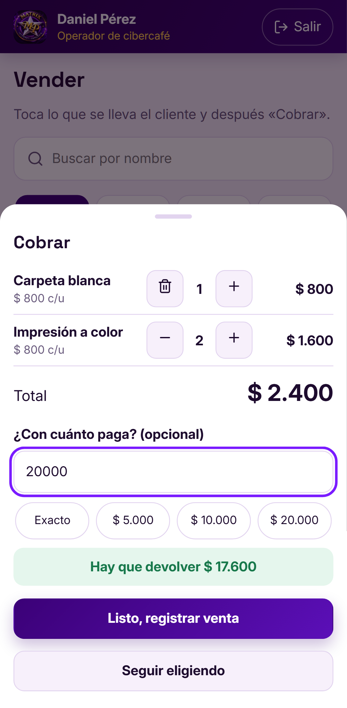

## Guía 03. Configuración

| Archivo | Para qué sirve |
|---------|----------------|
| `package.json` | Dependencias y órdenes. Vue, el router y los íconos van al navegador; lo demás es de desarrollo. |
| `tsconfig.json` | Reglas estrictas del comprobador de tipos. |
| `vite.config.ts` | Plugin de Vue y reenvío de `/api` al backend. |
| `vitest.config.ts` | Limita Vitest a las pruebas unitarias. |
| `playwright.config.ts` | Tamaño de teléfono, simulación y servidor de pruebas. |
| `.env.example` | Direcciones configurables. No lleva secretos. |

## Guía 04. Dominio

Las reglas están en `src/domain/` y no importan Vue ni HTTP.

| Regla | Archivo |
|-------|---------|
| No vender más de lo que hay, prendas únicas y tope de 150 | `model/Carrito.ts` |
| Campos obligatorios y límites de cada artículo | `model/Articulo.ts` y `constants/articulos.ts` |
| Usuario y contraseña obligatorios | `valueobjects/credenciales.ts` |
| Leer dinero y calcular el cambio | `valueobjects/dinero.ts` |
| Sesión vencida tras los minutos que indica el servidor | `model/Session.ts` |
| Acuerdos con el exterior | `ports/out/` |

Las validaciones muestran todos los errores a la vez, cada uno bajo su campo.

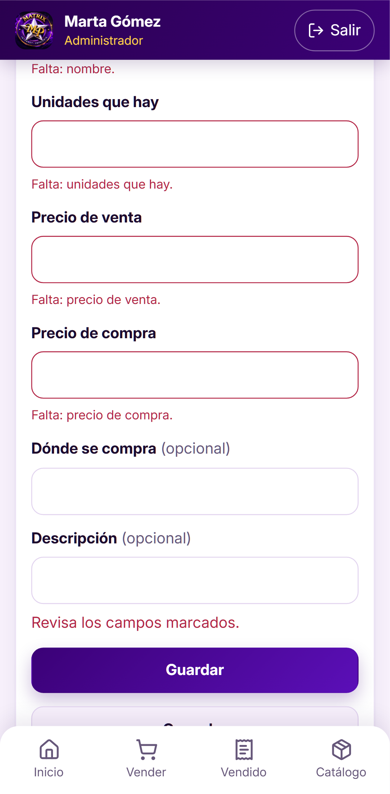

## Guía 05. Aplicación

`AuthService`, `CatalogService` y `SaleService` ordenan los pasos de cada operación. La interfaz recibe `UsuarioActual`, que no incluye el código secreto de la sesión. Al cobrar, el servicio manda el total que vio el cliente, y el servidor rechaza la venta si un precio cambió.

## Guía 06. Adaptadores

`HttpClient` pone el código de sesión, limita la espera y convierte los errores de la API en un `ErrorDeApi`. Un 401 cierra la sesión; un 403 la conserva. `ApiMapper` traduce los nombres de la API, por ejemplo `precioVenta`. `BrowserSessionStore` guarda la sesión en la pestaña.

## Guía 07. Inyección de dependencias

`bootstrap/container.ts` es el único lugar que crea las implementaciones concretas. Los servicios reciben sus dependencias por el constructor, así que en las pruebas les paso un almacenamiento en memoria y una API falsa. Vue entrega la aplicación a las pantallas con `provide` e `inject`.

## Guía 08. Del HTML a la pantalla

`index.html` carga `main.ts`, que arma la aplicación, crea el router y monta `App.vue`. El router recibe los casos de uso como parámetro. El guard `beforeEach` manda a la entrada a quien no tiene sesión, recuerda a dónde quería ir y no deja al operador abrir los formularios.

## Guía 09. Entrada e inicio

La entrada avisa cuando la contraseña está mal o cuando la sesión se cerró. El inicio muestra lo vendido hoy y tres accesos grandes, distintos según el rol.

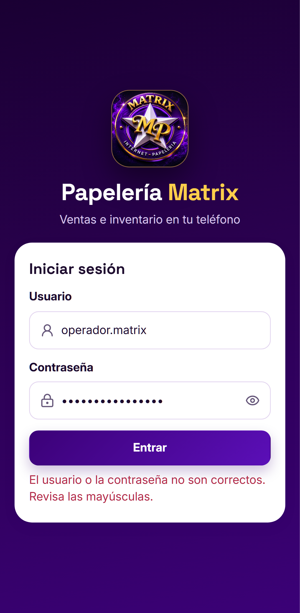

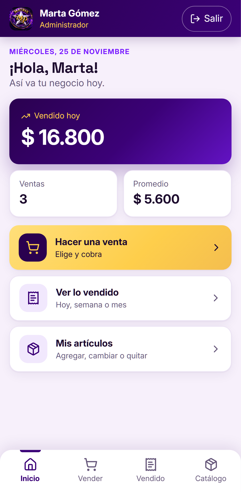

## Guía 10. Crear, consultar, editar y eliminar

La administradora hace las cuatro operaciones sobre servicios, papelería y ropa. Eliminar pide confirmación.

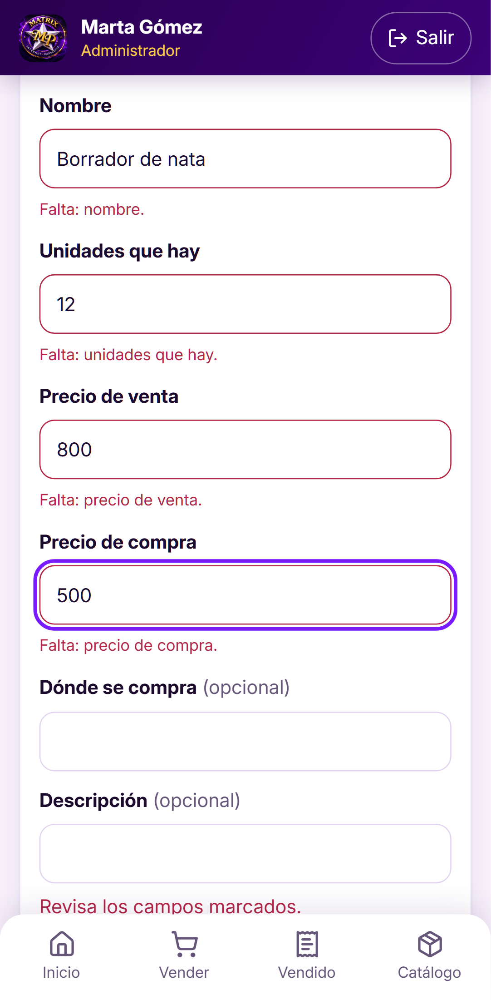

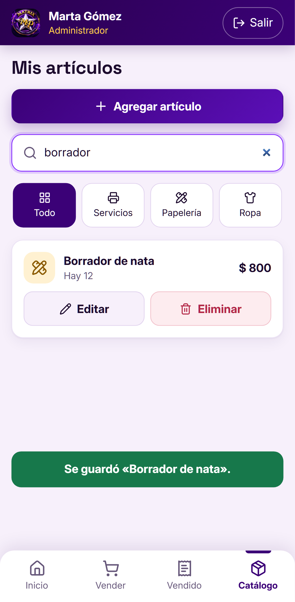

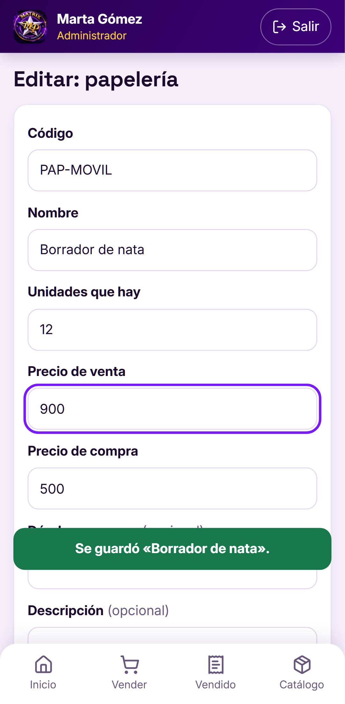

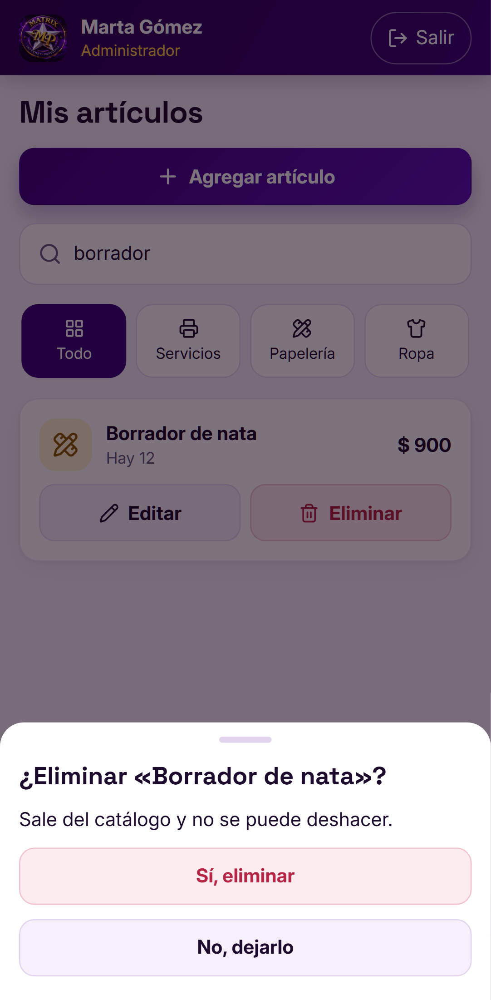

El operador ve el catálogo sin botones para cambiarlo.

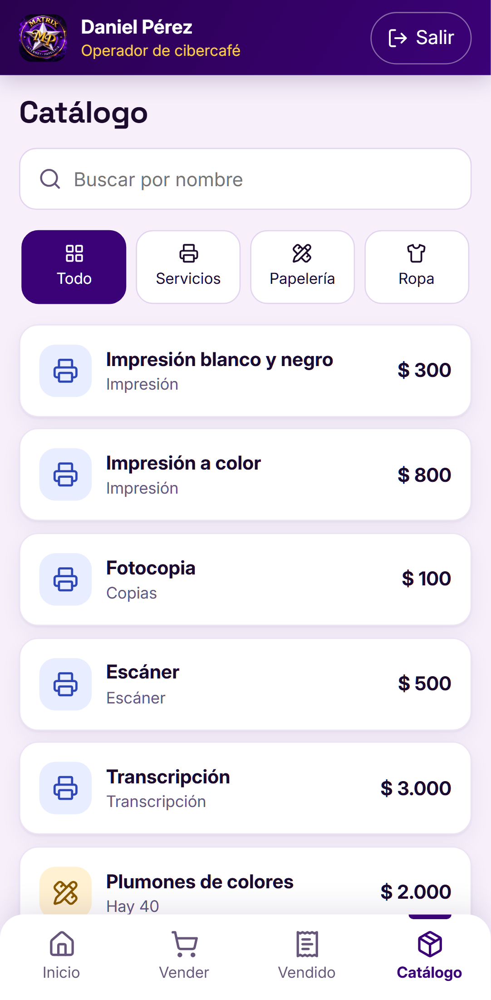

## Guía 11. Estilos

`styles.css` define en `:root` los colores de la marca. El menú inferior y las listas usan Flexbox y Grid. Los botones miden al menos 44 píxeles para tocarlos con el dedo. La barra y el menú respetan los bordes del teléfono con `safe-area-inset`. Una prueba comprueba que ninguna pantalla se salga a lo ancho.

Cada tipo de artículo tiene su icono y su color. Mientras llegan los datos se muestran bloques de carga, y las animaciones se apagan si el teléfono pide menos movimiento.

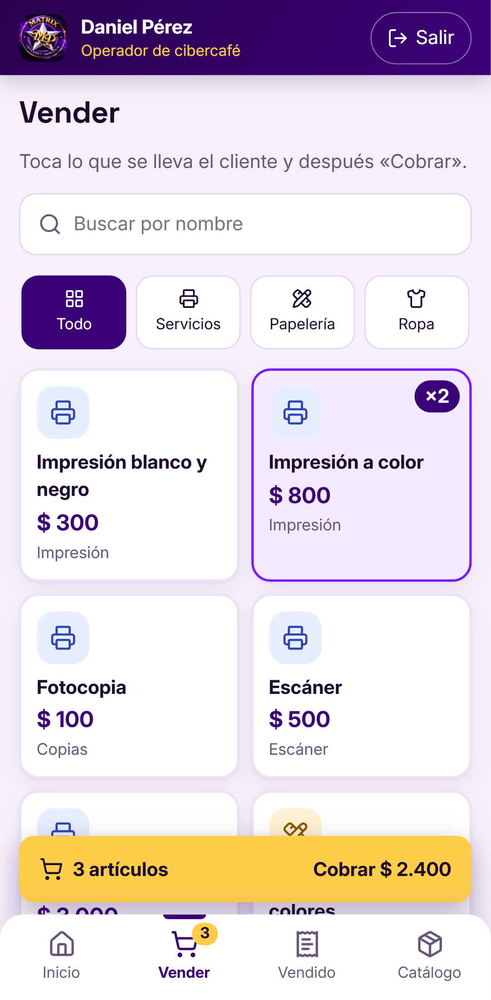

## Guía 12. Pruebas

Las unitarias están en `tests/unit/` y las de navegador en `tests/e2e/matrix.spec.ts`. Las de navegador usan la simulación de Postman (`postman/mocks/matrix-api/`), así no dependen de la base de datos.

| Prueba de navegador | Estado |
|---------------------|--------|
| Protege las pantallas, rechaza una clave mala y vuelve al destino | Hecho |
| El operador cobra con cambio y solo consulta el catálogo | Hecho |
| La administradora crea, edita y elimina un artículo | Hecho |
| La administradora vende a nombre de un operador y anula la venta | Hecho |
| Un 403 conserva la sesión y un 401 la cierra | Hecho |
| La sesión sigue al recargar y salir la borra | Hecho |
| Ninguna pantalla se sale del ancho del teléfono | Hecho |

## Guía 13. Seguir una operación y depurarla

Este es el recorrido de una venta.

1. `SellView.vue` llama `ventas.cobrar` con el carrito.
2. `SaleService` comprueba que haya artículos y, si es la administradora, que haya operador.
3. `SaleHttpAdapter` arma la petición y `HttpClient` la envía a `POST /api/ventas`.
4. El servidor descuenta las existencias y responde 201.
5. La pantalla muestra el recibo y vuelve a leer el catálogo.

Para depurar miro en este orden la consola, la pestaña de red (dirección, método, estado y respuesta) y el almacenamiento de la pestaña.

Estas son peticiones reales del recorrido contra el backend.

| Petición | Estado |
|----------|--------|
| `POST /api/sesion` con la contraseña mal | 401 |
| `POST /api/sesion` | 200 |
| `POST /api/ventas` | 201 |
| `POST /api/productos` | 201 |
| `PUT /api/productos/{id}` | 200 |
| `DELETE /api/productos/{id}` | 204 |
| `DELETE /api/ventas/{id}` | 204 |
| `DELETE /api/sesion` | 204 |

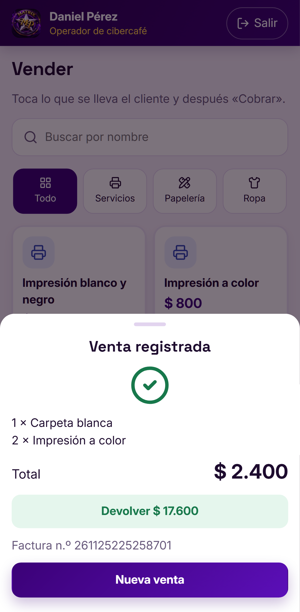

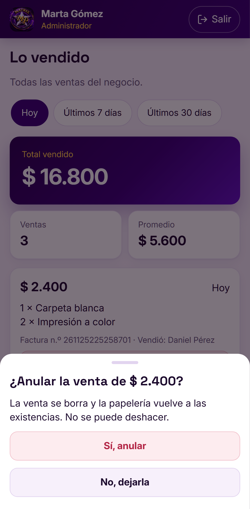

## Guía 14. Inventario

| Archivo | Para qué existe |
|---------|-----------------|
| `src/main.ts` | Arranca la aplicación |
| `src/vite-env.d.ts` | Tipos de las variables de Vite |
| `src/bootstrap/container.ts` | Arma las dependencias |
| `src/domain/constants/roles.ts`, `articulos.ts` | Roles, tipos, límites y campos |
| `src/domain/exceptions/errors.ts` | Errores del negocio y de la API |
| `src/domain/valueobjects/credenciales.ts`, `dinero.ts` | Datos validados y cálculos de dinero |
| `src/domain/model/Session.ts`, `Articulo.ts`, `Carrito.ts`, `Venta.ts` | Modelos y sus reglas |
| `src/domain/ports/out/AuthGateway.ts`, `CatalogGateway.ts`, `SaleGateway.ts`, `SessionStore.ts` | Acuerdos con el exterior |
| `src/application/ports/in/use-cases.ts` | Operaciones que usa la interfaz |
| `src/application/dto/commands/commands.ts`, `responses/responses.ts` | Datos de entrada y salida |
| `src/application/mapper/SessionMapper.ts` | Quita el código secreto de la sesión |
| `src/application/services/AuthService.ts`, `CatalogService.ts`, `SaleService.ts` | Casos de uso |
| `src/adapters/dto/requests/requests.ts`, `responses/responses.ts` | Formato de la API |
| `src/adapters/mapper/ApiMapper.ts` | Traduce entre la API y el dominio |
| `src/adapters/storage/BrowserSessionStore.ts` | Sesión en el navegador |
| `src/adapters/http/HttpClient.ts`, `AuthHttpAdapter.ts`, `CatalogHttpAdapter.ts`, `SaleHttpAdapter.ts` | Peticiones a la API |
| `src/entrypoint/gui/App.vue`, `router.ts`, `context.ts`, `useCatalog.ts`, `styles.css` | Marco, rutas, estado compartido y estilos |
| `src/entrypoint/gui/components/BottomSheet.vue`, `ArticleFilter.vue` | Ventana inferior y buscador |
| `src/entrypoint/gui/views/` | Entrada, inicio, vender, vendido, catálogo y formulario |
| `tests/unit/`, `tests/e2e/`, `tests/evidencias/recorrido.mjs` | Pruebas y capturas |
| `postman/mocks/`, `postman/simulations/` | Simulación de la API |
| `public/` | Logo y fuentes de la marca |
| `capacitor.config.ts`, `.env.apk` | Nombre de la aplicación y API que usa el APK |
| `src/adapters/http/pedirNativo.ts`, `src/entrypoint/native.ts` | Red de Android, botón Atrás y barras del sistema |
| `android/` | Proyecto de Android creado con Capacitor, con el icono del negocio |
| `.github/workflows/apk-movil.yml` | Genera el APK en GitHub |

`node_modules/`, `dist/`, `test-results/` y los registros los generan las herramientas y no se suben. `package-lock.json` sí se sube.

## El APK para Android

Usé Capacitor, que empaqueta la misma aplicación de Vue dentro de una aplicación de Android. No hay una segunda versión del código.

| Paso | Qué hace |
|------|----------|
| `npm run build:apk` | Compila Vue con la dirección de la API publicada y copia el resultado a `android/` |
| `./gradlew assembleDebug` | Arma el APK. Lo ejecuta GitHub, porque en mi computador faltan herramientas de Android |

Dentro del APK las peticiones las hace Android, porque el servidor rechaza con 403 las peticiones que llegan de un origen de navegador que no conoce. `pedirNativo.ts` ocupa el lugar de `fetch` y `HttpClient` no cambia, que es la inyección de dependencias de la guía 07.

El botón Atrás cierra la ventana abierta, vuelve de pantalla o minimiza la aplicación.

Es un APK firmado con la clave de desarrollo. Sirve para instalarlo directamente, no para publicarlo en una tienda.

## La app en iPhone

Un iPhone no instala APK. Para usarla allí publiqué la versión web en Vercel y se agrega a la pantalla de inicio desde Safari. Queda con el logo y se abre a pantalla completa. Es gratis y no necesita un computador Mac.

| Archivo | Qué hace |
|---------|----------|
| `index.html` y `public/manifest.webmanifest` | Nombre, icono y pantalla completa |
| `vercel.json` | Pasa las peticiones de `/api` al servidor y devuelve `index.html` en las demás rutas |

El servidor rechaza los orígenes que no conoce. Por eso `vercel.json` quita la cabecera de origen solo cuando la petición viene de esta misma app. Las de otras páginas siguen siendo rechazadas.

## Lo que quedó fuera

- [ ] Probar el APK en un teléfono físico.
- [ ] Publicarla en una tienda. Requiere firmas propias de Google y de Apple.
- [ ] Usar datos reales. El servidor publicado está en modo demo y sus datos se reinician.
- [ ] Operadores, claves, datos de la tienda y cuentas. Siguen en la versión web.
- [ ] Paginación desde el servidor. Requiere cambiar el backend.
